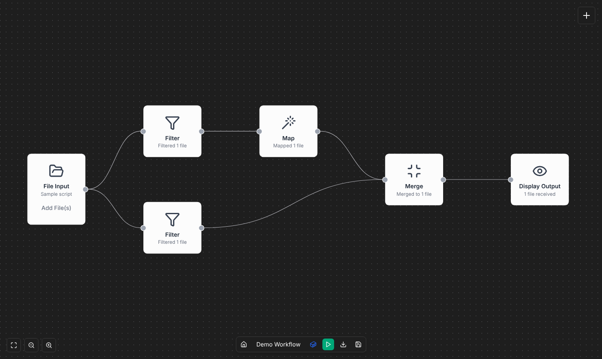

# N-WAVE

**Nextflow Workflow Authoring and Visualization Environment**

[](https://github.com/HCIstudio/N-WAVE/actions/workflows/test.yml)
[](https://hcistudio.github.io/N-WAVE/)
[](https://github.com/HCIstudio/N-WAVE/releases/latest)
[](https://hub.docker.com/r/hcistudio/nwave-frontend)
[](https://hub.docker.com/r/hcistudio/nwave-backend)
[](LICENSE)

N-WAVE is a visual editor for [Nextflow](https://www.nextflow.io/) workflows. You connect
nodes on a canvas (file inputs and samplesheets, [nf-core](https://nf-co.re/) tools, operators,
your own processes, outputs), and N-WAVE writes the Nextflow script, runs it and shows what
each step produced.



- **Try it:** the [browser demo](https://hcistudio.github.io/N-WAVE/) needs no installation.
  It builds, edits and exports workflows; running them needs an installation.
- **Learn it:** the [wiki](https://github.com/HCIstudio/N-WAVE/wiki) starts with
  [your first workflow in 10 minutes](https://github.com/HCIstudio/N-WAVE/wiki/First-Workflow).
  The **Glossary** in N-WAVE explains the terms.

## What it does

- **Build** workflows from nodes, with checks while you build, undo, copy and paste, and
  templates ([Building workflows](https://github.com/HCIstudio/N-WAVE/wiki/Building-Workflows),
  [Node reference](https://github.com/HCIstudio/N-WAVE/wiki/Nodes)).
- **Use nf-core**: over 2,000 modules, the subworkflows, and whole pipelines such as
  nf-core/rnaseq ([nf-core library](https://github.com/HCIstudio/N-WAVE/wiki/nf-core-Library)).
- **Add your own steps** as custom nodes, and share them as node packs
  ([Custom nodes](https://github.com/HCIstudio/N-WAVE/wiki/Custom-Nodes),
  [Node packs](https://github.com/HCIstudio/N-WAVE/wiki/Node-Packs)).
- **Run** them with Docker, follow each step, resume failed runs, and run on a SLURM cluster
  ([Running workflows](https://github.com/HCIstudio/N-WAVE/wiki/Running-Workflows),
  [Run profiles](https://github.com/HCIstudio/N-WAVE/wiki/Run-Profiles)).
- **Export** a runnable Nextflow project that works without N-WAVE
  ([Exporting projects](https://github.com/HCIstudio/N-WAVE/wiki/Exporting-Projects)).
- **Understand failures**: common errors are explained in plain language
  ([Troubleshooting](https://github.com/HCIstudio/N-WAVE/wiki/Troubleshooting)).

## Running N-WAVE

### With Docker

You need Docker running. Download `latest.yml` from the
[latest release](https://github.com/HCIstudio/N-WAVE/releases/latest), then:

```bash
docker compose -f latest.yml up -d
```

Open <http://localhost:5173> (the API is on <http://localhost:5001>). Run results go to
`./results`. Stop with `docker compose -f latest.yml down`. Updating, data and memory are
covered in [Installation](https://github.com/HCIstudio/N-WAVE/wiki/Installation).

### Who can reach N-WAVE

Only this computer: the ports are bound to `127.0.0.1`, and the backend listens on
`127.0.0.1` when run from source. N-WAVE has no login, and it starts containers through the
host's Docker, so anyone who can reach it can run code on this computer. To open it to a
trusted network anyway, set `NWAVE_BIND_ADDRESS=0.0.0.0` and add the address people open to
`CORS_ORIGIN` (see [Security](#security)).

### From source

```bash
docker compose up -d --build   # build and run the full stack, plus MongoDB on 127.0.0.1:27017
```

For development with hot reload, run MongoDB, the backend (`cd backend && pnpm install &&
pnpm dev`, port 5001) and the frontend (`cd frontend && pnpm install && pnpm dev`, port
5173). [CONTRIBUTING.md](CONTRIBUTING.md) has the details. `VITE_DEMO_MODE=true pnpm build`
in `frontend/` builds the browser demo.

## Architecture

```
 browser ──► frontend (React, nginx) :5173 ──/api──► backend (Express) :5001 ──► MongoDB
             canvas, script generator                 │  saved workflows
                                                      └──► Nextflow (nextflow/nextflow image,
                                                           or a local binary) ──► steps in Docker
```

- The **frontend** (`frontend/`) holds the canvas and turns the graph into a Nextflow script in
  the browser. It talks to the backend only through `frontend/src/api.ts`; the browser demo
  swaps that client for in-browser storage (`frontend/src/demo/`).
- The **backend** (`backend/`) stores workflows in MongoDB, installs nf-core components, runs
  Nextflow and serves run logs and results under `/api` ([backend/README.md](backend/README.md)).

### How workflow execution works

The backend doesn't bundle Nextflow. `NEXTFLOW_EXECUTION_MODE` decides how it runs:

| Value | Behavior |
| --- | --- |
| `docker` | Run Nextflow in the official `nextflow/nextflow` image on the host's Docker, sharing files with `--volumes-from`. Needs only Docker; the Docker setups use this. |
| `local` | Use a `nextflow` binary on the host (needed for SLURM runs). |
| `auto` (default) | A local binary if there is one, else the container. |

For this, the Docker setups mount the host's Docker socket into the backend and give it a fixed
`container_name`. The N-WAVE images are built for `linux/amd64` and `linux/arm64`. Many
`nextflow/nextflow` tags exist only for `linux/amd64`, so the runner uses that platform by
default (emulated on ARM; `NEXTFLOW_PLATFORM=native` uses the host's). The images' old docker
CLI is told the engine's minimum API version, since Docker Engine 29 refuses it otherwise
(`DOCKER_API_VERSION` overrides it).

## Configuration

### Backend environment variables

| Variable | Default | Purpose |
| --- | --- | --- |
| `PORT` | `5001` | API port. |
| `HOST` | `127.0.0.1` | Address the API listens on; the Docker image sets `0.0.0.0`. |
| `MONGODB_URI` | `mongodb://localhost:27017/nwave` | MongoDB connection string. |
| `CORS_ORIGIN` | `http://localhost:5173,http://localhost:8080` | Comma-separated origins allowed to call the API. |
| `NEXTFLOW_EXECUTION_MODE` | `auto` | `docker`, `local` or `auto` (see [execution](#how-workflow-execution-works)). |
| `NEXTFLOW_PLATFORM` | `linux/amd64` | Platform of the Nextflow runner container; `native` uses the host's. |
| `BACKEND_CONTAINER_NAME` | `nwave-backend` | Container the runner shares volumes with. |
| `DOCKER_API_VERSION` | the engine's minimum | Docker API version the runner's docker CLI uses. |
| `NWAVE_MAX_CPUS` | all CPUs | Most CPU cores a run may use. |
| `NWAVE_MAX_MEMORY` | 80% of memory | Most memory a run may use, e.g. `24 GB`. |
| `NWAVE_EXECUTION_TIMEOUT` | `1440` | Time limit in minutes for runs that set none; `0` for none. |
| `NWAVE_DATA_DIR` | `results/.nwave` | Installed nf-core components and the run history. |
| `NWAVE_CUSTOM_NODE_DIR` | `results/.nwave/custom-nodes` in `latest.yml` | Where custom nodes and node packs are stored. |

The Docker setups also read `NWAVE_BIND_ADDRESS` (default `127.0.0.1`), the address their
ports are published on.

### Frontend build variables

| Variable | Default | Purpose |
| --- | --- | --- |
| `VITE_DEMO_MODE` | `false` | `true` builds the browser demo (in-browser storage, no runs). |
| `VITE_BASE_PATH` | `/` | Base path for sub-path hosting, e.g. `/N-WAVE/` on GitHub Pages. |
| `VITE_API_BASE_URL` | `/api` | Where the frontend sends API requests. |
| `VITE_NODE_PACK_INDEX_URL` | the [N-WAVE-node-packs](https://github.com/HCIstudio/N-WAVE-node-packs) index | Community index under **Node packs → Import**. |

[`.env.example`](.env.example) is a starting point for the from-source Docker build.

## Security

N-WAVE is built for **local, single-user use**: your own computer or a trusted lab workstation.

- **No login.** Anyone who can reach the backend can read, change and delete all workflows
  and start runs.
- **Runs are code execution by design.** A workflow runs arbitrary Nextflow (and so shell)
  code, and the backend has the host's Docker socket, which equals root on the host.
- **Guards, not a sandbox.** Request bodies are validated with size limits, input file
  names can't leave the run folder, and values on the Nextflow command line are checked and
  quoted. These stop mistakes, not attacks.

So keep the ports on `localhost` or a trusted network, never on the public internet, and only
run workflows you trust. What a shared installation would need (logins, per-user data,
sandboxed runs) is [#27](https://github.com/HCIstudio/N-WAVE/issues/27). Please report
vulnerabilities privately to the maintainers, not in a public issue.

## Repository layout

```
N-WAVE/
├─ frontend/        # React app: canvas, nodes, panels, script generator, browser demo (frontend/README.md)
├─ backend/         # Express API: workflows, nf-core installs, runs (backend/README.md)
├─ scripts/         # nf-core catalog generator and parsers, Nextflow lint (scripts/README.md)
├─ wiki/            # source of the wiki pages (wiki/README.md)
├─ docker-compose.yml  # full stack built from source
├─ latest.yml       # full stack from the published images (shipped with each release)
└─ .github/workflows/  # CI, releases, demo deploy
```

## CI and releases

Every pull request runs the `Test` workflow (lint, unit tests with coverage floors,
typecheck, build, Nextflow lint of the generated scripts, and end-to-end tests), and `main` only
accepts green pull requests. Every merge to `main` is released automatically: version bump,
Docker images, the demo site and a GitHub Release with `latest.yml`. Details, and how to set a
new minor or major version, are in [CONTRIBUTING.md](CONTRIBUTING.md#releases).

## Contributing

See [CONTRIBUTING.md](CONTRIBUTING.md) for the development setup, the checks every pull
request must pass, and how releases work. Bugs and ideas go to the
[issues](https://github.com/HCIstudio/N-WAVE/issues).

## License

Apache License 2.0. See [`LICENSE`](LICENSE) and [`NOTICE`](NOTICE).
