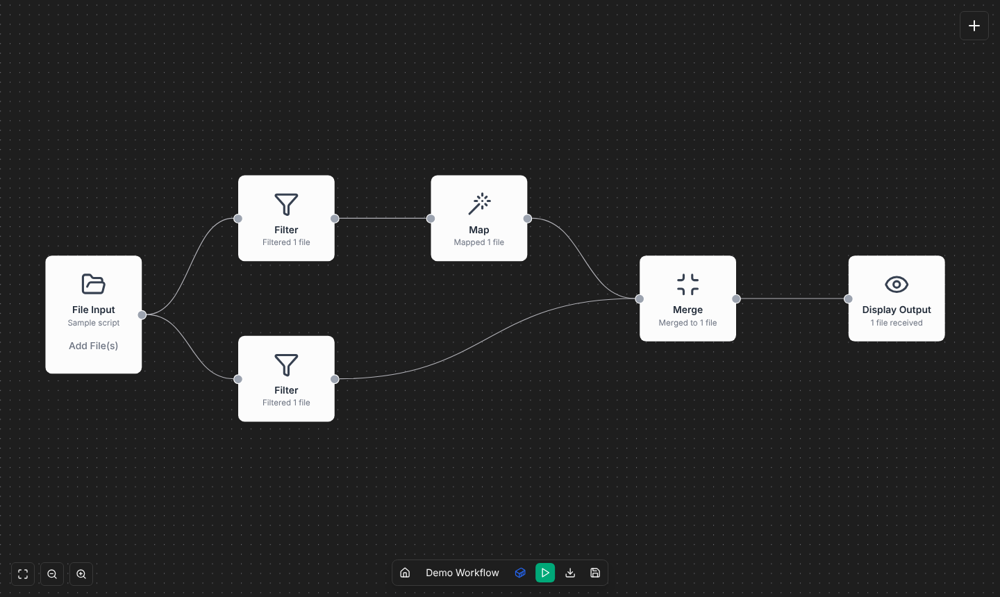

**N-WAVE** (Nextflow Workflow Authoring and Visualization Environment) is a visual editor for
[Nextflow](https://www.nextflow.io/) workflows. You connect nodes on a canvas (inputs,
[nf-core](https://nf-co.re/) tools, operators, outputs), and N-WAVE writes the Nextflow script,
runs it and shows the results.

## Start here

1. **Try it** in the [browser demo](https://hcistudio.github.io/N-WAVE/), no installation
   needed (building and exporting only), or [install it](https://github.com/HCIstudio/N-WAVE/wiki/Installation)
   with Docker to run workflows.
2. **Build your first workflow** in 10 minutes:
   [First workflow](https://github.com/HCIstudio/N-WAVE/wiki/First-Workflow). Or open
   take the [courses](#courses), starting with the basics.

## Courses

**Courses** on the home page: short hands-on lessons in N-WAVE itself. Each step shows you
something or asks you to do it (open a panel, add a node, connect it), and goes on once you
have. A card says what to do (at the top left of the canvas, at the bottom right on other
pages); what it is about is outlined. When a step is on another page, the card says so and
links there.

- **Basics**, in the browser (the online demo too):
  - **The home page**: what is where. It ends with you making a workflow of your own (**New
    Workflow**, then Demo 1), which opens with the next course.
  - **The canvas**: in your copy of Demo 1, open a node's settings and change it, remove a
    node, add it back from the + menu and connect it. Started from **Courses**, it makes the
    copy itself.
  - **Build with nf-core modules**: a Samplesheet, FastQC and MultiQC from the nf-core
    Library, connected and exported.
  - **Import and export**: in a copy of Demo 1, download the project, the script and the DAW
    model, then import the script on the home page and get the same canvas back.
  - **Your own steps**: write a custom process, add it, read its Code tab, and share it as a
    node pack.
  - **Large workflows**: in a copy of Demo 3, the whole workflow at once, the steps inside a
    subworkflow, and grouping steps into a subworkflow of your own.
  - **Choices in a workflow**: in a workflow imported for the course, two aligners both
    feed one report; add a Branch from the + menu, set its condition, put an aligner in each
    arm, switch the parameter and read the `if` / `else` in the export. Then else if,
    switches, nested branches, skip flags and why loops stay code.
  - **N-WAVE for studies**: in Global Settings, switch a help feature off and on, turn on
    verbose mode, set a participant ID, mark a test and download the recording.
- **Advanced**, with an [installation](https://github.com/HCIstudio/N-WAVE/wiki/Installation)
  (greyed out in the online demo):
  - **Run a workflow**: in a copy of Demo 1, run it and follow it in the run panel (Steps, Log),
    minimize and expand the panel, read a step's Results and Display Output, find the run in
    History, cancel a run, and see the runs on the home page.
  - **When a run fails**: a workflow imported for the course fails in a step with a typo. Read
    why (the explanation and its evidence in the log), fix the typo with **Edit custom node**,
    resume (the finished step comes from the cache), run in full with Resume off, and where the
    run cache is.
  - **Run an nf-core pipeline**: in a copy of Demo 2, nf-core/rnaseq as one Pipeline node: its
    form, the test data it gets from the Samplesheet and Reference genome nodes, a run, its
    reports, and its steps inside.
  - **Run limits and clusters**: a workflow's resources and the run limits in Global Settings,
    a SLURM run profile, choosing it for the workflow, and the profile in the exported project.
    No cluster is needed.
  - **Read a workflow's structure**: in a workflow imported for the course, a Branch node
    (if/else) that a parameter switches between two aligners, Analyse (and an error it
    finds), the Specification and Dependencies views, and a group.

Every major feature gets a course: the plan is in
[#241](https://github.com/HCIstudio/N-WAVE/issues/241), and each release from v1.7 on brings
the course for its features.

On your first visit, the home page offers the first course. A course can be left at any time
and taken again from **Courses**.

## Guides

| Page | For |
| --- | --- |
| [Building workflows](https://github.com/HCIstudio/N-WAVE/wiki/Building-Workflows) | Adding and connecting nodes, the workflow check, templates, import, shortcuts |
| [Node reference](https://github.com/HCIstudio/N-WAVE/wiki/Nodes) | What every node does and its settings |
| [nf-core library](https://github.com/HCIstudio/N-WAVE/wiki/nf-core-Library) | Installing and using nf-core modules, subworkflows and pipelines |
| [Custom nodes](https://github.com/HCIstudio/N-WAVE/wiki/Custom-Nodes) and [Node packs](https://github.com/HCIstudio/N-WAVE/wiki/Node-Packs) | Steps of your own, and sharing them |
| [Running workflows](https://github.com/HCIstudio/N-WAVE/wiki/Running-Workflows) | The run panel, settings, resources, resuming, where results are |
| [Run profiles](https://github.com/HCIstudio/N-WAVE/wiki/Run-Profiles) | Running on a SLURM cluster or AWS Batch |
| [Exporting projects](https://github.com/HCIstudio/N-WAVE/wiki/Exporting-Projects) | Running a workflow without N-WAVE |
| [Importing workflows](https://github.com/HCIstudio/N-WAVE/wiki/Importing-Workflows) | Opening Nextflow scripts and projects on the canvas |
| [DAW model](https://github.com/HCIstudio/N-WAVE/wiki/DAW-Model) | Exporting and importing a workflow in a language-neutral form |
| [Troubleshooting](https://github.com/HCIstudio/N-WAVE/wiki/Troubleshooting) | Failed runs, Docker, paths, the first slow run |
| [How N-WAVE explains things](https://github.com/HCIstudio/N-WAVE/wiki/How-N-WAVE-Explains-Things) | What each of N-WAVE's explanations is based on, how sure it is and its limits |

**Examples:** [Running the nf-core/rnaseq pipeline](https://github.com/HCIstudio/N-WAVE/wiki/Running-the-nf-core-rnaseq-Example)
(Demo 2) · [RNA-seq rebuilt from nodes](https://github.com/HCIstudio/N-WAVE/wiki/RNA-seq-STAR-Salmon-Example)
(Demo 3)

## Elsewhere

- **Help** in N-WAVE: what N-WAVE does, the node colors, the canvas, and a glossary of every
  term (process, channel, tuple, `meta`, samplesheet, …) in a sentence or two. Open it from the
  home page, the canvas's **?** button, or the ⓘ buttons next to the terms.
  Online: [Help in the demo](https://hcistudio.github.io/N-WAVE/help).
- **[README](https://github.com/HCIstudio/N-WAVE#readme)**: overview, configuration, security
  and architecture.
- **[CONTRIBUTING.md](https://github.com/HCIstudio/N-WAVE/blob/main/CONTRIBUTING.md)**:
  developing N-WAVE, its checks and releases.
- **[Issues](https://github.com/HCIstudio/N-WAVE/issues)**: report a bug or ask for a feature.

These pages are edited in the repository's
[`wiki/` folder](https://github.com/HCIstudio/N-WAVE/tree/main/wiki), together with the code
they describe.
